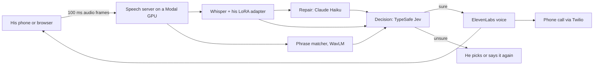

# My Voice

**A speech translator built for one person.** Most people catch only one word in five or ten of what our co-designer
says, and stock speech recognisers do worse. My Voice listens with a speech model trained on his own voice, shows what
he said in large type, and says it out loud in a clear voice he chose: across a shop counter, at the dinner table, or
on a phone call.

**Live:** https://trymyvoice.vercel.app (access code `heard`). Works in Safari on an iPhone and in any desktop browser.

<p>
  
  
</p>

## The problem

He already has a speech app. It takes about five seconds per sentence and struggles when other people talk nearby. In
that gap a conversation moves on without him, and a phone call to family is hardly possible.

He asked for four things, and we turned each into a number we measure:

| He asked for | What we measure | Where it stands |
| --- | --- | --- |
| Faster than his current app | End of his sentence to text, and to voice | Text in 1.3 to 1.9 s, voice in 1.8 to 2.4 s on live turns |
| Understands far more of his words | Words recognised on recordings no model trained on | 48% with stock Whisper, 79% with his model |
| Works with people talking nearby | The same recordings mixed with other voices | 20% stock, 62% his model |
| Works on phone calls | A real call with his voice on the line | Calls to real phones through Twilio, and app-to-app calls from any browser |

We added two of our own: **useful within ten minutes of first opening it**, and **never say a sentence out loud that it
was unsure of**.

## Three promises

- **It learns him, not the average speaker.** Every sentence he records, confirms or corrects makes the next one easier.
  Corrections and repeated phrases count straight away; everything else goes into the next training run.
- **It would rather ask than guess.** When it is sure, it speaks. When it is not, it shows him up to three sentences to
  tap, or asks him to say it again. A wrong sentence said in his name is the worst outcome, so the bar for speaking is
  measured, not guessed.
- **His voice stays his.** His recordings stay on our server and his phone. Only text goes to the language models and
  the voice service. Nothing the other person says on a call is stored.

## What you can try

<p>
  
  
  
</p>
<p>
  
  
  
</p>

- **Talk.** One large button. He speaks; the sentence fills the screen and is spoken aloud. Flip turns the card to face
  the person in front of him. "That's wrong" lets him correct it, and the correction is remembered.
- **When it is not sure, it asks.** Nothing is said aloud. He taps the right sentence from up to three, says it again,
  or types it.
- **Phrases.** His everyday sentences, one tap each, spoken at once from stored audio, even with no connection.
- **Calls.** A call to a real phone number: the other person hears his clear voice, and he reads their words as
  captions. Or he shares a six-digit code, a friend opens the link in any browser and taps Call, and his phone shows an
  incoming-call screen modelled on the iPhone's.
- **Teach.** Short sentences to read aloud, including new ones written to sound like his own. "Improve now" trains a
  new version of his model in a few minutes, and it replaces the old one only if it understands him better on
  recordings it has never heard.
- **Results.** Stock Whisper against every version of his model, condition by condition, with the number of clips
  behind each figure.
- **Tell the app.** He says what he wants changed ("make the text bigger", "talk a bit slower"), sees the change in
  plain words, and taps Apply. If no setting matches, nothing changes.

## How well it understands him

His model was trained on 50 sentences he read aloud. It is tested on 10 more that no model has ever trained on, first
as recorded and then mixed with recorded chatter from other speakers. Accuracy is the share of words recognised
correctly.

| Condition | Stock Whisper | His model |
| --- | --- | --- |
| Quiet room | 48% | **79%** |
| Others talking nearby (5 dB) | 20% | **62%** |
| Others talking loudly (0 dB) | 0% | **26%** |

The recogniser is only the first step. A decision step then lets a sentence be spoken only above a confidence bar
measured on his own test recordings: the lowest bar at which fewer than 2 in 100 spoken sentences are wrong. Below it,
he chooses. Every number in this README comes from a real run on the deployed system. The full tables, including what
we tried and dropped, are in [docs/IMPROVEMENTS.md](docs/IMPROVEMENTS.md).

## What makes it work

### A model of his voice, from 50 sentences

Research on very atypical speech keeps finding the same thing: a model personalised on a person's own recordings beats
any general model, and most of the gain comes from the first few minutes of audio. So his model is Whisper
large-v3-turbo with a small LoRA adapter trained only on his voice ([trainer.py](server/voice/training/trainer.py)).

- **Trained for the noise it will meet.** Training clips are mixed with chatter from a bank of 20 multi-speaker tracks
  and slightly sped up or slowed down ([augment.py](server/voice/training/augment.py),
  [babble.py](server/voice/training/babble.py)).
- **Settings chosen without touching the test set.** Five-fold cross-validation on his 50 training sentences, eleven
  variants, three seeds each. Waiting longer before stopping training cut the error on held-out folds from 67.4% to
  54.3% ([scripts_train_cv.py](server/scripts_train_cv.py)).
- **A new version has to earn its place.** It is scored on a frozen test set with the same GPU type and decoder as the
  live server, and promoted only if it is at least half a point better on average and no more than 1 point worse in
  quiet ([promotion.py](server/voice/training/promotion.py)). That rule is why his current model is live: a later
  version did better in noise but 1.2 points worse in quiet, so the earlier one stays.

### Three ways of listening at once

- **His recogniser** returns its five best guesses, with how many search paths agreed on each and a confidence per word
  ([whisper.py](server/voice/asr/whisper.py)).
- **A phrase matcher that works on sound alone.** His saved phrases are compared with his own recordings of them using
  self-supervised speech features (WavLM) and dynamic time warping, so a phrase he says often is recognised even when
  its words are hard to make out ([matcher.py](server/voice/phrases/matcher.py)).
- **It starts before he finishes.** When he pauses for 300 ms, recognition starts on the audio so far; if he does not
  go on, that result is used. Recognition now finishes 27 to 378 ms after he stops, against 720 to 1,000 ms before
  ([flow.py](server/voice/turns/flow.py)).

### A decision step that would rather ask

- **Repair.** Claude Haiku rebuilds likely sentences from the recogniser's guesses and the phrase matches, and may only
  use words it can explain from them ([repair.py](server/voice/gate/repair.py)).
- **Decide.** TypeSafe's Jev, called through TypeSafe's own API, gives a calibrated probability for each candidate,
  with "none of these" as an option. It is told how often each guess came up and how accurate his current model really
  is ([decide.py](server/voice/gate/decide.py)). Giving it that measured evidence instead of hand-written hints raised
  its probability on correct sentences from 0.20 to 0.45 up to 0.70 to 0.83, while a real near-miss ("flat white"
  against "fat white") still went the right way.
- **Calibrated per model, applied live.** A replay of his test recordings through the whole pipeline sets his speaking
  bar on the server whenever his model changes. His bar is 0.80. The alternative decision model needed 0.98, because
  its probabilities sit near 0 or 1 even when it is wrong, which is why Jev is the default
  ([pipeline_eval.py](server/voice/evaluation/pipeline_eval.py), [act.py](server/voice/gate/act.py)).
- **Corrections count at once.** A sentence he corrects is remembered and favoured the next time it comes up
  ([memory.py](server/voice/gate/memory.py)).

### A voice that arrives fast

- ElevenLabs Flash v2.5 in a mature male voice he can change, with every spoken sentence cached so repeats play at once
  ([elevenlabs.py](server/voice/tts/elevenlabs.py)).
- Connections to TypeSafe, ElevenLabs and Anthropic open as soon as the app connects, which cut the first decision from
  over 1.5 s to 140 to 390 ms.
- **Streamed voice** (on the Experiments screen) plays each sentence as it arrives over one long-lived connection. The
  first sound comes about a quarter of a second after the text appears, and under 0.1 s for a sentence he has said
  before.

### Calls

- **Phone calls** go through Twilio Media Streams: his voice goes down the line as 8 kHz audio, and the other person's
  speech becomes captions in memory and is never stored ([twilio.py](server/voice/calls/twilio.py),
  [captions.py](server/voice/calls/captions.py)).
- **App-to-app calls** need no phone number and cost nothing: a six-digit code or link opens a call page in any
  browser, where the friend hears his voice and sees each sentence in large type ([calls/](server/voice/calls)).

### Lip reading, in progress

His lips carry information that his consonants do not, especially with other voices around. The groundwork is built and
live behind the Experiments screen: the front camera tracks his mouth in the browser with MediaPipe without ever
showing the picture, sends grey mouth crops to the server, and lines them up with the audio through a 10-second sync
check ([experiments/lips](app/features/experiments/lips), [server/voice/lips](server/voice/lips)). Next is using that
signal to tell his voice from others and to settle ties between sentences that sound alike.

## What we tried and dropped

Measured, then left out because the numbers said so:

- **Cleaning the audio first.** Eight denoisers and filters, including DeepFilterNet, MetricGAN+ and SepFormer. Every
  one raised his error rate, in quiet and in noise: they smear the consonant cues his model relies on, so Whisper hears
  the raw audio.
- **A 5x faster decoder** (CTranslate2): 140 ms instead of 706 ms per sentence, but 2.5 points worse in quiet for him.
  Parked until it matches.
- **A newer model version** that was better in noise but slightly worse in quiet (see above).

## How it is built



| Part | Technology | Where |
| --- | --- | --- |
| App | Expo SDK 58 (React Native): one codebase for the iPhone and the web, Geist, Moti, lucide | [app/](app) |
| Server | FastAPI on one Modal A10G, a WebSocket per session, Silero VAD for the end of speech | [main.py](server/main.py), [session.py](server/voice/session.py) |
| Recogniser | Whisper large-v3-turbo with a PEFT LoRA adapter, 5-beam n-best | [asr/](server/voice/asr) |
| Phrase matcher | WavLM base plus with dynamic time warping | [phrases/](server/voice/phrases) |
| Decision | TypeSafe Jev by default, or OpenAI Decisions | [gate/](server/voice/gate) |
| Repair, Teach sentences, Tell the app | Claude Haiku 5.5 | [repair.py](server/voice/gate/repair.py), [teach/](server/voice/teach) |
| Voice | ElevenLabs Flash v2.5 | [tts/](server/voice/tts) |
| Calls | Twilio Programmable Voice with Media Streams | [calls/](server/voice/calls) |
| Training and evaluation | Separate Modal jobs on L40S and A10G GPUs | [jobs.py](server/jobs.py) |
| Web hosting | Vercel | [deploy-web.mjs](scripts/deploy-web.mjs) |

**How we check it:** about 180 server tests cover the logic that must be exact (word error rate, promotion,
calibration, audio framing, the decision rules), and a smoke check drives 12 flows against the live server with real
services in under two minutes ([smoke.mjs](scripts/smoke.mjs)). Every reply from a model or an API is validated before
use, with timeouts, retries, and a plain error in the app when something fails.

## Run it

You need Node 20+, [uv](https://docs.astral.sh/uv/), a [Modal](https://modal.com) account (`modal token new`), and keys
for the services below.

```bash
cp .env.example .env
```

| Variable | What it is for | Where to get it |
| --- | --- | --- |
| `APP_TOKEN`, `INTERNAL_TOKEN` | App-to-server and trainer-to-server tokens | Any long random strings |
| `TYPESAFE_API_KEY` | The decision step (Jev) | TypeSafe AI dashboard |
| `ANTHROPIC_API_KEY` | Repair, Teach sentences, Tell the app | console.anthropic.com |
| `ELEVENLABS_API_KEY`, `ELEVENLABS_VOICE_ID` | His clear voice | elevenlabs.io |
| `OPENAI_API_KEY` | Optional second decision provider | platform.openai.com |
| `TWILIO_ACCOUNT_SID`, `TWILIO_AUTH_TOKEN`, `TWILIO_FROM_NUMBER` | Phone calls | Twilio console |

Deploy the server, then the web app, then check every flow against the live server:

```bash
npm run deploy
```

```bash
npm run deploy:web
```

```bash
npm run smoke
```

To run the app locally instead: `cd app && npm install && npx expo start --web`. The iPhone build, demo-day steps and
troubleshooting are in [docs/RUNBOOK.md](docs/RUNBOOK.md).

## Limits and what comes next

- His model has 50 training sentences. Every sentence he records or confirms adds to the next version, and research on
  personal models shows accuracy still climbing well past that.
- Loud chatter right next to him is still hard (26%). Lip reading is the next step for it.
- The native iPhone app needs an Apple developer account to install; until then he uses the web app on his phone.
- Phone calls connect with his voice; live captions of the other person on a real phone line are not verified yet.
- His settings can sync with the AI for Accessibility toolkit profile; that link is built and waits for the toolkit
  service to be connected.

More: why each design choice was made ([docs/DECISIONS.md](docs/DECISIONS.md)), how his recordings were checked
([docs/DATA.md](docs/DATA.md)), and notes on every external API ([docs/API-NOTES.md](docs/API-NOTES.md)).
