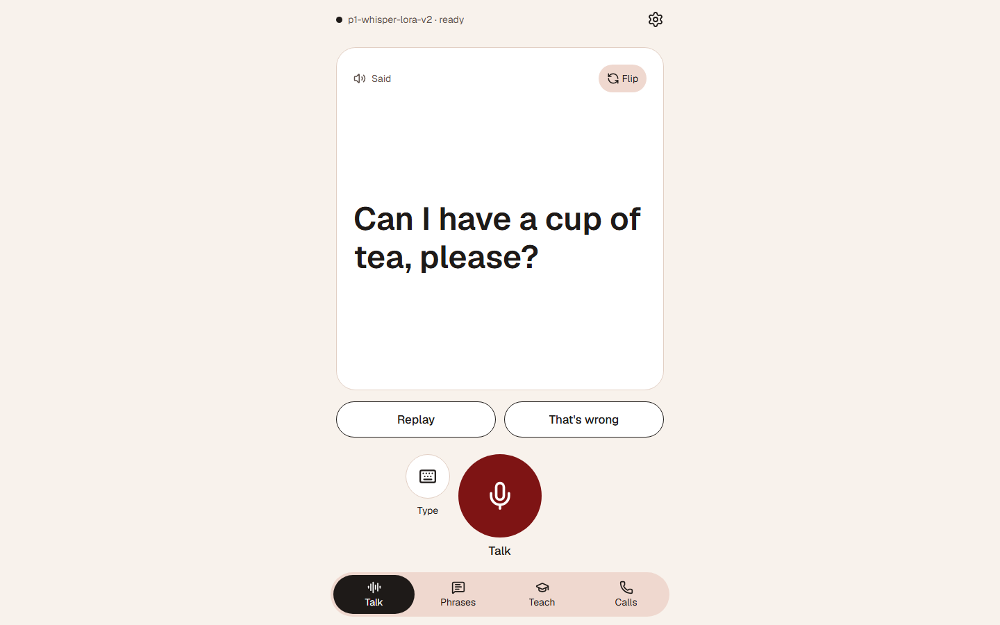
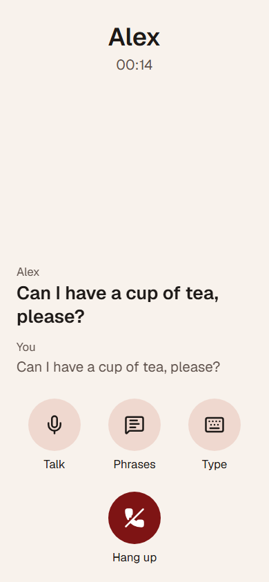
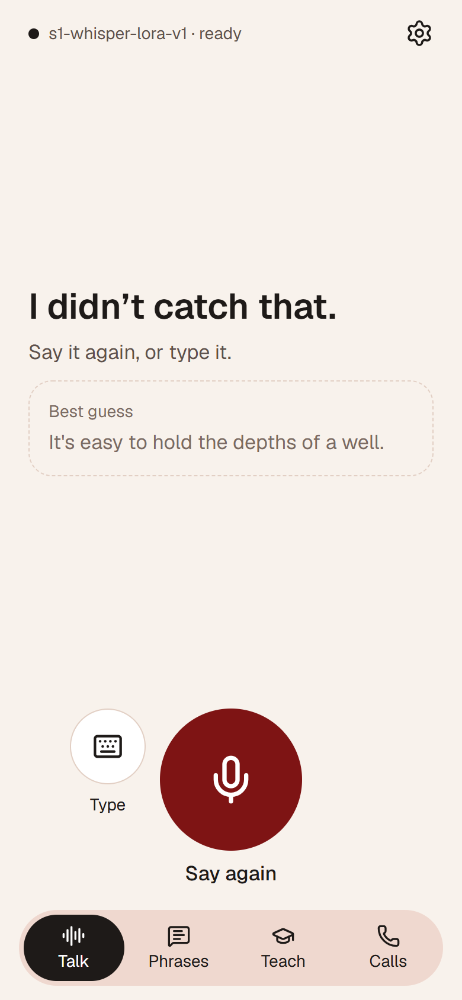
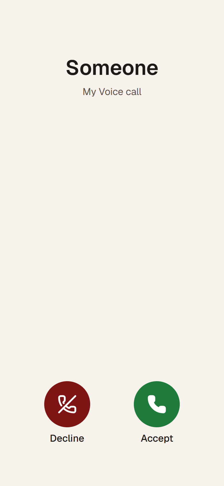
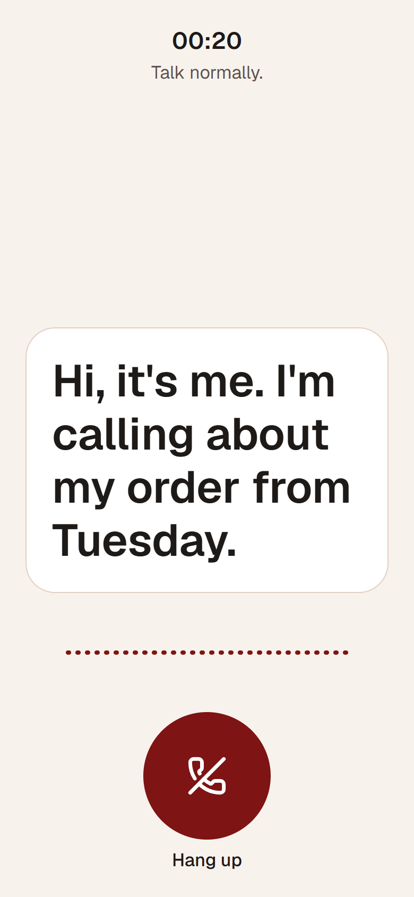
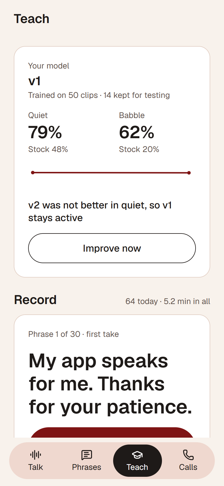
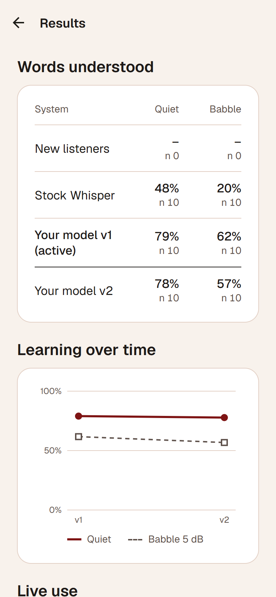
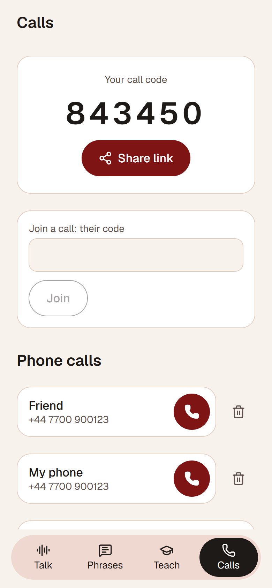
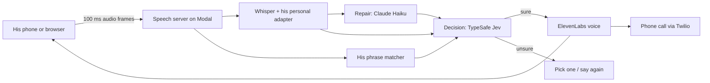

# My Voice

A speech translator for one person. Our co-designer talks; most people catch one word in five or ten, and stock speech
recognisers do worse. My Voice listens to him with a model trained on his own voice, shows what he said in large type,
and says it out loud in a clear voice he chose. In a shop, at home, or on the phone.

<p>
  
  
</p>

## Why it exists

He already has a speech app. It takes about five seconds per sentence and struggles when other people talk nearby.
In that gap a conversation moves on without him, and a phone call to family is hardly possible.

My Voice is built around three promises to him:

- **It learns him, not the average speaker.** Every sentence he records, confirms or corrects makes the next one easier
  to understand. Repeated phrases and corrections count straight away; everything else goes into the next training run.
- **It would rather ask than guess.** When it is sure, it speaks. When it is not, it shows him up to three sentences to
  tap, or asks him to say it again. A wrong sentence said out loud in his name is the worst outcome, so the bar for
  speaking is set from his own test recordings.
- **His voice stays his.** His recordings live on our server and his phone. Only text leaves for the language models
  and the voice; nothing the other person says on a call is stored.

## What it does

- **Talk.** Press the button, speak, and the sentence appears in large type and is spoken aloud, usually within two
  seconds, with his voice following straight after.
- **Phrases.** His everyday sentences, one tap each, spoken at once from stored audio.
- **Teach.** Short sentences to read aloud. One button trains a new version of his model; it replaces the old one only
  if it understands him better on recordings it has never heard.
- **Calls.** He rings a real phone number and the other person hears his clear voice while he reads their words as
  captions. Or he shares a short code, and a friend opens a link in any browser to call him app to app.
- **Results.** How well stock Whisper and each of his models understand him, condition by condition, measured on
  recordings kept aside for testing.

Try it at https://trymyvoice.vercel.app (access code `heard`).

<p>
  
  
  
</p>
<p>
  
  
  
</p>

## How well it understands him

Measured on his 10 test recordings, which no model ever trained on, first as recorded in a quiet room and then mixed
with recorded chatter. Accuracy is the share of words recognised correctly.

| Condition | Stock Whisper | His model |
| --- | --- | --- |
| Quiet room | 48% | 79% |
| Other people talking nearby | 20% | 62% |

The recogniser is only the first step. Its bar for speaking aloud is set on the same test recordings, as the lowest
bar at which fewer than 2 in 100 spoken sentences are wrong; below it, he picks or says it again.

Full numbers, including what was tried and dropped, are in [docs/IMPROVEMENTS.md](docs/IMPROVEMENTS.md).

## How it works



1. **Listen.** The app streams his microphone to the server, which finds the end of each sentence from the silence
   after it ([endpointing.py](server/voice/audio/endpointing.py)).
2. **Recognise.** Whisper large-v3-turbo with a LoRA adapter trained on his recordings returns its five best guesses
   ([whisper.py](server/voice/asr/whisper.py), [trainer.py](server/voice/training/trainer.py)). In parallel, his
   saved phrases are matched by sound alone ([matcher.py](server/voice/phrases/matcher.py)).
3. **Repair.** Claude Haiku rebuilds likely sentences from those guesses, without adding meaning he did not express
   ([repair.py](server/voice/gate/repair.py)).
4. **Decide.** TypeSafe's Jev, called through TypeSafe's own API, scores how likely each candidate is to be what he
   said ([decide.py](server/voice/gate/decide.py)). Above his threshold it speaks; otherwise he chooses
   ([act.py](server/voice/gate/act.py)).
5. **Speak.** ElevenLabs Flash v2.5 says it in the voice he picked, streamed so the first words arrive early
   ([elevenlabs.py](server/voice/tts/elevenlabs.py)). On a call the same audio goes down the phone line
   ([twilio.py](server/voice/calls/twilio.py)).

The app is Expo (React Native) and runs on the iPhone and in any browser from one codebase ([app/](app)). The server is
one FastAPI app on a single Modal GPU ([server/main.py](server/main.py)); training and evaluation run as separate Modal
jobs ([server/jobs.py](server/jobs.py)).

## Run it

You need Node 20+, [uv](https://docs.astral.sh/uv/), a [Modal](https://modal.com) account (`modal token new`), and
keys for the services below.

```bash
cp .env.example .env
```

| Variable | What it is for | Where to get it |
| --- | --- | --- |
| `APP_TOKEN`, `INTERNAL_TOKEN` | App-to-server and trainer-to-server tokens | Any long random strings |
| `TYPESAFE_API_KEY` | The decision step (Jev) | TypeSafe AI dashboard |
| `ANTHROPIC_API_KEY` | Repair, Teach sentences, settings in his own words | console.anthropic.com |
| `ELEVENLABS_API_KEY`, `ELEVENLABS_VOICE_ID` | His clear voice | elevenlabs.io |
| `OPENAI_API_KEY` | Optional second decision provider | platform.openai.com |
| `TWILIO_ACCOUNT_SID`, `TWILIO_AUTH_TOKEN`, `TWILIO_FROM_NUMBER` | Phone calls | Twilio console |

Deploy the server and the web app, then check every flow against the live server:

```bash
npm run deploy
```

```bash
npm run deploy:web
```

```bash
npm run smoke
```

To run the app locally instead: `cd app && npm install && npx expo start --web`. Running on an iPhone, demo-day steps
and troubleshooting are in [docs/RUNBOOK.md](docs/RUNBOOK.md).

## Limits and what comes next

- His model has 50 training sentences so far. Every sentence he records and confirms is more to learn from.
- Two people talking at once next to him is still hard; reading his lips as a second input is being explored.
- The iPhone app needs an Apple developer account to install; until then he uses the web app on his phone.
- Phone calls connect over Twilio with his voice; live captions of the other person on a real phone line are not yet
  verified.

Design choices and why: [docs/DECISIONS.md](docs/DECISIONS.md). His recordings and how they were checked:
[docs/DATA.md](docs/DATA.md). Notes on every external API: [docs/API-NOTES.md](docs/API-NOTES.md).
